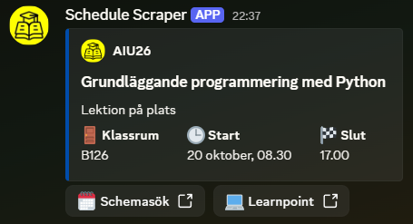

# Schedule Scraper

A Python application that fetches the next day's class schedule for AIU26 at Campus Varberg and sends it as a custom embedded Discord message.

I started this project to learn Python, but it eventually evolved into working with HTTP requests, HTML parsing, and APIs.

## Preview

## Features

- Fetches schedule information from Campus Varberg's website.
- Extracts course title, classroom, and lesson start + end times with BeautifulSoup.
- Sends a formatted Discord embed with a custom icon and links relevant to our programme.
- Skips weekends.
- Mock testing support for local testing using a saved HTML file.
- Safeguards for network errors, missing schedule information, and some unexpected responses.

## Testing

The scraper has a mock mode that allows reading an HTML file rather than making requests to the school's website.

## Limitations
- The application is specifically tailored to work with the HTML structure of Campus Varberg's website.
- Online lectures are not listed on the website and can therefore currently not be detected.